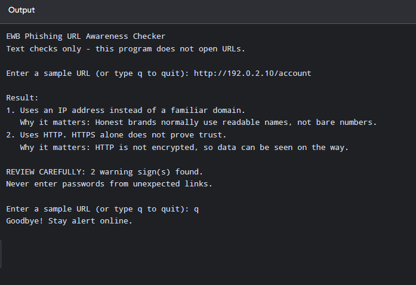
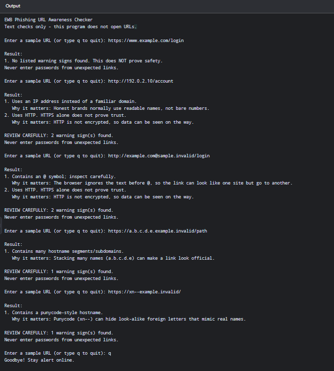

# EWB Phishing URL Awareness Checker

## Overview
Phishing is a trick where criminals send fake links or messages to make people share passwords, card numbers or OTPs. This Python command-line tool reads the *text* of a URL and points out a few visible warning signs. It never opens the link.

## Features
- Detects an @ symbol in the URL
- Flags unusually long URLs (over 100 characters)
- Flags IP-address hostnames
- Flags many hostname segments (5 or more)
- Flags punycode-style hostnames (xn--)
- Flags the HTTP scheme
- Loop mode: check many URLs without restarting (type `q` to quit)
- "REVIEW CAREFULLY" summary with the number of warnings
- Safe handling of malformed input (no crash)
- A short "why it matters" explanation under every warning
- Numbered and spaced output

## Requirements
Python 3.10 or later. No extra packages.

## How to Run
Windows: `python phishing_checker.py`

Mac/Linux: `python3 phishing_checker.py`

## Example Output
```
EWB Phishing URL Awareness Checker
Text checks only - this program does not open URLs.

Enter a sample URL (or type q to quit): http://192.0.2.10/account

Result:
1. Uses an IP address instead of a familiar domain.
   Why it matters: Honest brands normally use readable names, not bare numbers.
2. Uses HTTP. HTTPS alone does not prove trust.
   Why it matters: HTTP is not encrypted, so data can be seen on the way.

REVIEW CAREFULLY: 2 warning sign(s) found.
Never enter passwords from unexpected links.
```

## Testing
| # | Input | Expected | Actual | Result |
|---|-------|----------|--------|--------|
| 1 | https://www.example.com/login | No warning signs | No listed warning signs found. This does NOT prove safety. | PASS |
| 2 | http://192.0.2.10/account | IP address + HTTP | IP address warning + HTTP warning | PASS |
| 3 | http://example.com@sample.invalid/login | @ symbol + HTTP | @ symbol warning + HTTP warning | PASS |
| 4 | https://a.b.c.d.e.example.invalid/path | Many hostname segments | Many hostname segments warning | PASS |
| 5 | https://xn--example.invalid/ | Punycode-style hostname | Punycode warning | PASS |

Full table with bonus checks: `tests/test_samples.md`

## Screenshots



## Improvements
1. **Loop with quit** - the program keeps asking for URLs until the user types `q`, so there is no need to restart it. Tested by entering several URLs in one run.
2. **Review carefully summary** - a helper function separates real warnings from info messages and prints the warning count. Tested with URLs that have and have no warnings.
3. **Crash fix for malformed input** - `try/except` around `urlparse` stops the `ValueError` for input like `http://[bad`. Tested with that input.
4. **Explanations** - a dictionary maps each warning to a one-line reason. Re-ran all five tests after adding it.

## Limitations
This is an educational tool. It only reads URL text. It does not visit URLs, scan for malware or prove that a URL is safe. No warning signs found does NOT mean a URL is safe.

## Ethical Use
Use sample strings only. Do not collect credentials. Do not use this project to deceive anyone or to test websites without permission.

## Author
Gaurav Kumar, Cyber Security, EWB Courses

Submission date: 31/10/2026
